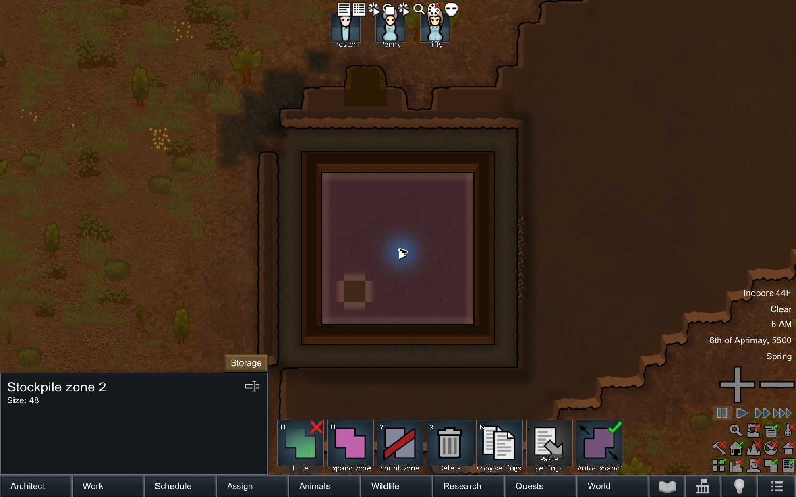

# Expando Zone

<!-- merthsoft-download -->
## Download

[Download expando-zone.zip](https://merthsoft.com/RimWorld/expando-zone.zip) — RimWorld 1.7 release.

The archive includes older supported version folders where available. Extract the mod folder into RimWorld's `Mods` directory.
<!-- /merthsoft-download -->

Expando Zone adds a separate stockpile tool that automatically fills the available space in a room.

## Use the Expando Zone tool

1. Open **Architect > Zone > Expando Zone**. Choose this separate tool when you want automatic expansion.
2. Place a small seed zone, such as a single cell, inside the room you want to use for storage.
3. Unpause and allow the game to run briefly. With **Auto-Expand** enabled (the default), the zone fills eligible empty cells in that room on its next periodic update.
4. Select the zone to change its storage settings or toggle **Auto-Expand**.

Existing normal stockpiles keep their cells and settings. Automatic expansion skips cells already occupied by another zone, as well as fogged cells and objects that cannot overlap zones. You can keep a normal stockpile beside an Expando Zone in the same room.

## Keep a manually chosen shape

Pause the game, create or select an Expando Zone, and turn **Auto-Expand** off before resuming. You can then manually add or remove zone cells using the usual zone tools without automatic room fill restoring them. Turning the toggle off does not remove cells already added. Turn it back on when you want automatic expansion again, or use a normal stockpile for storage that never needs automatic expansion.

## When expansion happens

Expansion is periodic and requires the game to be running. The mod checks the currently viewed map and uses the room containing the zone's first cell. Place the seed wholly inside the intended room. Rooms classified by the game as huge are skipped, so do not rely on automatic filling of open outdoor spaces. Expansion adds cells; it does not automatically shrink the zone.

## Gameplay example

The selected Expando Zone occupies 48 cells of the 7×7 interior; the existing normal stockpile retains its one cell. The checked **Auto-Expand** toggle appears at the right of the selected zone commands. 
